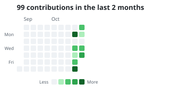

## Edward Mitby, MS

Senior AI Engineer building **agentic workflows**: LLM-powered agents that plan, use tools and carry out multi-step work. My background is in systematic macro investing and machine learning for financial markets.

### Focus areas

- **Agentic workflows**: multi-step agents, tool use, and orchestration
- **Applied machine learning**: data scrubbing, ensemble modeling, XGBoost, ML for forecasting
- **Quantitative finance**: signal research, factor modeling, portfolio construction, and backtesting

### Featured agentic projects

- [**Study Sprint MCP**](https://github.com/emitby/study-sprint-mcp): the learning app rebuilt on the Model Context Protocol. The five agents reach their tools through an MCP server, with a capability token per agent, tool pinning against poisoning, and a guardrail hook pipeline. A read-only learner server serves the lessons to Claude Desktop and Claude Code. A cost ledger prices every tool in tokens and dollars, and MCP itself is measured too: 0 extra tokens and about 1.8 ms per call. Evals: 27/27 live lessons over MCP, 67/67 MCP red-team cases, 216/216 direct-vs-MCP parity, and 14 planted defects caught. Includes a 15-page PDF of charts and commentary.
- [**Replicating an Asset Management Firm with Agents and Task Decomposition**](https://github.com/emitby/Replicating-an-Asset-Management-Firm-with-Agents-and-Task-Decomposition): five Claude agents replicate a firm's workflow, from data operations through quant research, performance analytics and investor relations to the investment team. They backtest a moving-average trend strategy and a five-lookback multi-asset momentum strategy (50/30/20 in the top three ETFs), compare both with SPY and QQQ, and produce a 29-page investor PDF. Code guardrails verify every number in it. Evals: 14/14 scorers in 3 of 3 live trials, 43/43 red-team cases and an independent cross-check.
- [**Agentic Prototype for an Encrypted Personal Assistant**](https://github.com/emitby/Agentic-Prototype-for-an-Encrypted-Personal-Assistant-That-Minimizes-the-Risk-of-Big-Data-Profiling): a coordinator delegates to security, travel and household agents. They check passwords against Have I Been Pwned using k-anonymity, search flights, and track groceries and supplies. Everything is stored in an AES-256-GCM vault, and secrets never reach the model. Evals: 30/30 live conversations with no secret in any request, 72/72 red-team cases, and an independent cross-check of the supply math.
- [**OpenTable for Banquet Halls Using Agentic Workflows**](https://github.com/emitby/OpenTable-for-Banquet-Halls-Using-Agentic-Workflows): an OpenTable-style booking app for banquet halls. A concierge agent delegates to venue-scout and pricing agents. Agents can only place holds; confirming a booking takes a human. Evals: 27/27 live conversations, 66/66 red-team cases, and 4,816 quotes cross-checked against an independent pricer. The live trials caught a real concurrency bug, now fixed.
- [**Dynamic Interactive Learning App Using Agentic Workflows**](https://github.com/emitby/Dynamic-Interactive-Learning-App-Using-Agentic-Workflows): pick any subject and grade (K to College), and five Claude agents build a lesson with three key concepts, an SVG diagram and a 5-question quiz. Intake scopes the topic, Curriculum writes the concepts, Diagram and Quiz work in parallel, and a Reviewer checks the facts. A 1-minute timer triggers random movement breaks (jumping jacks, high knees, push-ups). Code measures reading level, sanitizes diagrams, blocks unsafe subjects and grades on the server. Evals include 185 tests (with Playwright browser tests), 45 red-team cases and a live K-to-College matrix (9/9). Includes a 12-page PDF guide.

### Quant research

- [**Quant-Trading-Templates**](https://github.com/emitby/Quant-Trading-Templates): eight end-to-end quant projects covering momentum, breakouts, smart beta, alpha factors, NLP on 10-Ks, neural sentiment, signal combination and backtesting

### Tools

Python · Claude / Anthropic API · MCP (Model Context Protocol) · PyTorch · TensorFlow · scikit-learn · pandas · FastAPI · AWS

### Recent activity

<!-- contributions:start -->
<picture>
  <source media="(prefers-color-scheme: dark)" srcset="assets/contributions-dark.svg">
  
</picture>
<!-- contributions:end -->

### Connect

[LinkedIn](https://www.linkedin.com/in/edwardmitby)
